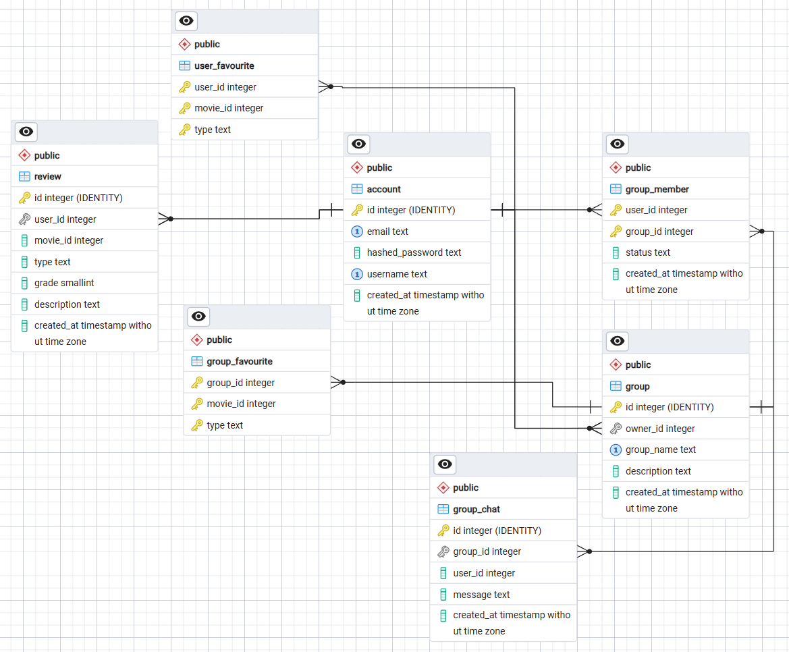

# Movie App

Movie App is a movie and TV series application built with React, Vite,
Express, and PostgreSQL. TMDB provides the media and image data, while
PostgreSQL stores users, reviews, favorites, and group data.

## Features

### Available to all users

- Browse movies that are currently playing in Finland's cinemas on the home page.
- Browse the highest-rated movies based on user reviews.
- Search for movies and TV series by name, type, genre, and release year.
- Navigate through paginated search results.
- View media details, including posters, image galleries, descriptions, release
  dates, and local ratings.
- View user profiles, their reviews and favorites.
- Read movie and TV series reviews.
- Create an account and sign in.

### Available to signed-in users

- Update your username and email address.
- Add, edit, and delete your own reviews with a rating from 1 to 5.
- Add movies and TV series to your favorites and view your favorites list.
- Create groups, send join requests, and manage groups.
- Approve and remove group members, or leave a group.
- Manage group favorites and use the group chat.
- Delete your account and its associated data.
- Sign out.

## Technologies

- Frontend: React 19, React Router, Axios, and Vite
- Backend: Node.js 24, Express 5, and JWT-based authentication
- Database: PostgreSQL
- External API: TMDB API
- API documentation: Swagger UI
- Tests: Mocha and Chai
- Development environment: Docker Compose

## Requirements

- Docker Desktop and Docker Compose
- A TMDB API token
- Node.js 24 and a local PostgreSQL server when running without Docker

## Configuration

Create a `.env` file in the project root by copying the example:

```bash
copy env_example .env
```

Set at least the following values:

```env
BACKEND_PORT=3001
FRONTEND_PORT=5173
POSTGRES_PORT=5432
POSTGRES_USER=yourusername
POSTGRES_PASSWORD=yourpassword
POSTGRES_HOST=database
POSTGRES_DB=dbname
TEST_POSTGRES_DB=dbname_test
TMDB_TOKEN=your_tmdb_token
JWT_SECRET_KEY=use_a_long_random_secret
VITE_API_URL=http://localhost:3001
```

When the backend is run with Docker Compose, `POSTGRES_HOST=database` is the
Compose service name. The browser still accesses the backend through
`http://localhost:3001`, so `VITE_API_URL` should remain a localhost URL.

## Running with Docker

Start the database, backend, and frontend in development mode:

```bash
docker compose up --build
```

The application is available at <http://localhost:5173>. The backend Swagger
UI is available at <http://localhost:3001/api-docs>.

Stop the services:

```bash
docker compose down
```

Remove the PostgreSQL Docker volume as well:

```bash
docker compose down -v
```

The database is initialized using
[`server/database/init.sql`](server/database/init.sql) and
[`server/database/seed.sql`](server/database/seed.sql). The database volume
preserves data after the services are stopped unless the `-v` option is used.

## Running without Docker

Install dependencies in the project root and the backend directory:

```bash
npm install
cd server
npm install
```

For a local PostgreSQL server, set `POSTGRES_HOST=localhost` in `.env` and
create the configured database. Initialize the schema and seed data from the
SQL files in `server/database` if needed.

Start the frontend and backend in separate terminals:

```bash
# terminal 1, from the project root
npm run dev
```

```bash
# terminal 2
cd server
npm run dev
```

## Tests and checks

Frontend linting and production build:

```bash
npm run lint
npm run build
```

The backend integration tests use the Docker `backend-test` service, the test
database, and the test profile. Make sure Docker is running and execute the
following command from the project root:

```bash
npm run test:docker
```

## Project structure

```text
src/                  React components, screens, and user context
server/controllers/   Backend request handlers
server/routers/       Express routes
server/models/        PostgreSQL queries and data models
server/middleware/    Authentication
server/database/      Schema, seed data, and test database
server/openapi.js     Swagger/OpenAPI definition
scripts/              Development and testing helper scripts
docker-compose.yml    Database, backend, and frontend services
```

## Main backend routes

All backend API routes use the `/api` prefix:

| Route | Purpose |
| --- | --- |
| `/api/search` | Search for movies and TV series |
| `/api/movie` | Media details, lists, and reviews |
| `/api/user` | Accounts, profiles, and user favorites |
| `/api/group` | Groups, memberships, group favorites, and chat |
| `/api-docs` | Swagger UI API documentation |

Routes that require authentication use a JWT token in the `Authorization`
header. The parameters, requests, and responses for all endpoints are
available in Swagger UI.

## Entity Relationship Diagram


